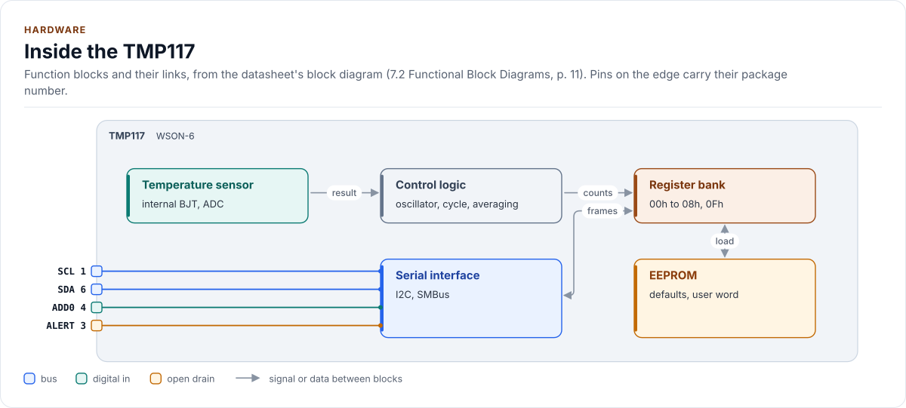
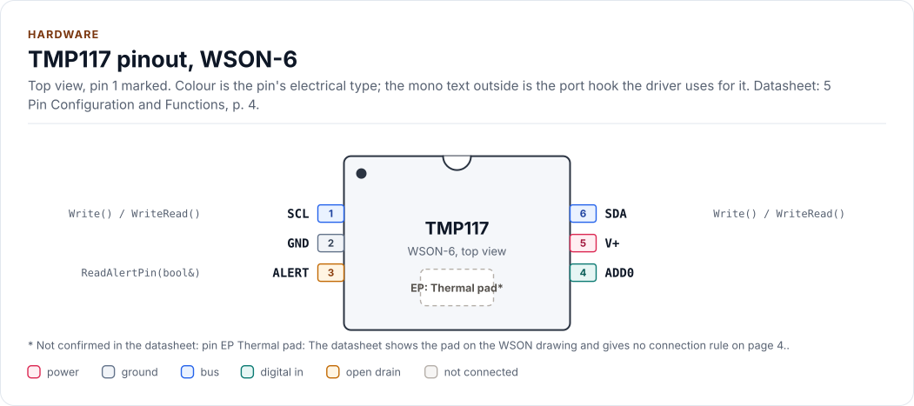
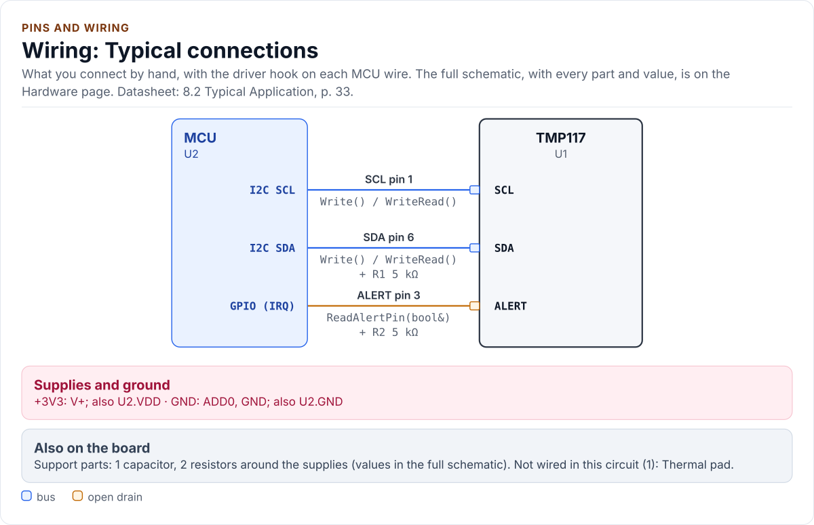
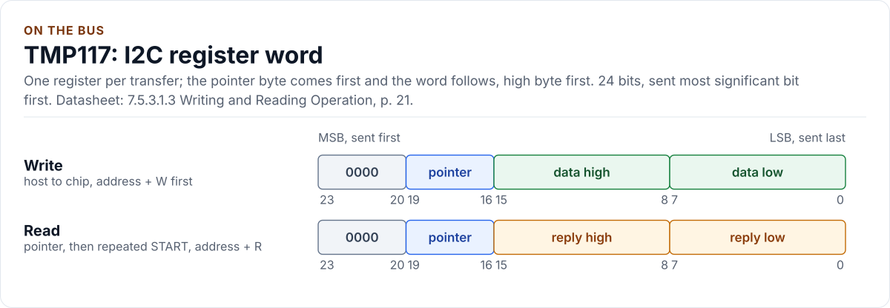
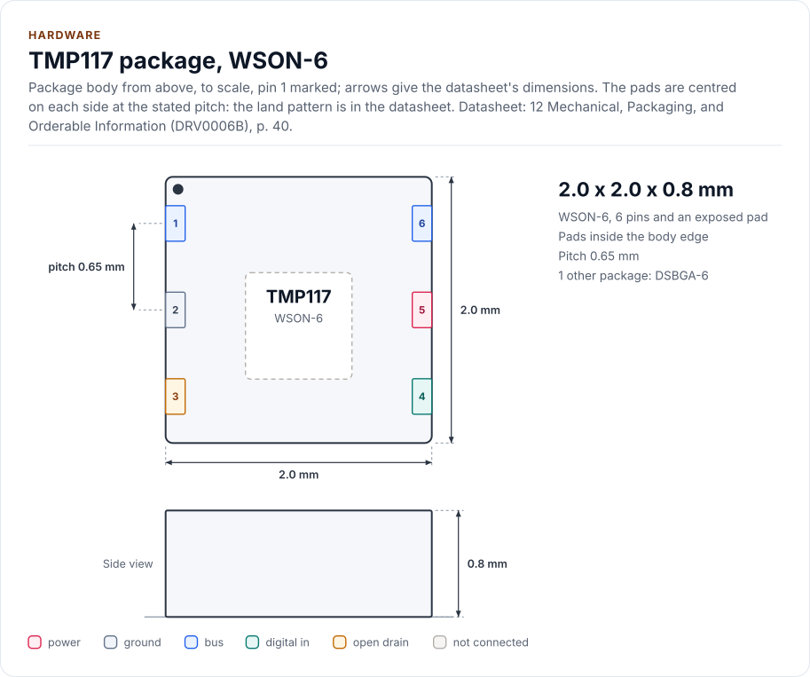

# TMP117 Driver

<!-- generated: chip-summary -->
The **TMP117** is a digital temperature sensor with a 16-bit result in steps of 1/128 °C, accurate to 0.1 °C from -20 °C
to 50 °C, a programmable alert window and a small EEPROM, read over I2C or SMBus (1 Features, [p.
1](https://www.ti.com/lit/gpn/TMP117#page=1)).
<!-- /generated -->

C++20 driver for the Texas Instruments TMP117 high-accuracy digital temperature sensor: it starts the chip safely,
reads it continuously or on demand, latches the alert flags the chip clears on read, and treats the chip's own EEPROM
as a guarded operation.

[](https://github.com/kokeb-labs-drivers/driver-tmp117/actions/workflows/ci.yml)
[](LICENSE)
[](docs/installation.md#requirements)
[](docs/testing.md#on-hardware)

**Documentation: [`docs/`](docs/index.md)**, with the API reference built by Doxygen ([how](docs/api-reference.md)).
The site at <https://kokeb-labs-drivers.github.io/driver-tmp117/> opens when the repository is public.


<!-- figure: chip-hero -->
<picture>
  <source media="(prefers-color-scheme: dark)" srcset="docs/diagrams/chip-hero.dark.svg">
  
</picture>
<!-- /figure -->

## What it does

<!-- figure: chip-capabilities -->
<picture>
  <source media="(prefers-color-scheme: dark)" srcset="docs/diagrams/chip-capabilities.dark.svg">
  
</picture>
<!-- /figure -->

## Where it is used

<!-- generated: chip-uses -->
- Electronic thermometers
- Wireless environmental sensors
- Thermostats
- Cold chain asset tracking
- Temperature transmitters

Uses named by the datasheet (1 Features, [p. 1](https://www.ti.com/lit/gpn/TMP117#page=1)).
<!-- /generated -->

## Inside the sensor

<!-- figure: chip-blocks -->
<picture>
  <source media="(prefers-color-scheme: dark)" srcset="docs/diagrams/chip-blocks.dark.svg">
  
</picture>
<!-- /figure -->

## Pins and wiring

<!-- figure: chip-pinout -->
<picture>
  <source media="(prefers-color-scheme: dark)" srcset="docs/diagrams/chip-pinout.dark.svg">
  
</picture>
<!-- /figure -->

<!-- figure: chip-wiring-typical -->
<picture>
  <source media="(prefers-color-scheme: dark)" srcset="docs/diagrams/chip-wiring-typical.dark.svg">
  
</picture>
<!-- /figure -->

| MCU | TMP117 | Notes |
| --- | --- | --- |
| I2C SCL | SCL (pin 1) | Pull-up to V+ only if the MCU pin is open drain |
| I2C SDA | SDA (pin 6) | 5 kΩ pull-up to V+ (Figure 8-1 of the datasheet) |
| GPIO (interrupt) | ALERT (pin 3) | 5 kΩ pull-up to V+; optional, read with the `ReadAlertPin()` hook |
| GND | ADD0 (pin 4) | Address `0x48` (`kI2cAddress`); V+, SDA or SCL give `0x49`, `0x4A`, `0x4B` |
| 3.3 V | V+ (pin 5) | 1.8 V to 5.5 V; 0.1 µF to GND close to the pin |
| GND | GND (pin 2) | The thermal pad of the WSON is left unconnected |

<!-- figure: chip-frame-i2c -->
<picture>
  <source media="(prefers-color-scheme: dark)" srcset="docs/diagrams/chip-frame-i2c.dark.svg">
  
</picture>
<!-- /figure -->

<!-- figure: chip-outline -->
<picture>
  <source media="(prefers-color-scheme: dark)" srcset="docs/diagrams/chip-outline.dark.svg">
  
</picture>
<!-- /figure -->

<!-- generated: chip-card -->
| | | Datasheet |
| --- | --- | --- |
| **Package** | WSON-6, exposed pad | 5, [p. 4](https://www.ti.com/lit/gpn/TMP117#page=4) |
| **Pins** | 6 | 5, [p. 4](https://www.ti.com/lit/gpn/TMP117#page=4) |
| **Body size** | 2.0 x 2.0 x 0.8 mm | 12, [p. 40](https://www.ti.com/lit/gpn/TMP117#page=40) |
| **Pin pitch** | 0.65 mm | 12, [p. 40](https://www.ti.com/lit/gpn/TMP117#page=40) |
| **Variants** | `dsbga` (below) | 12, [p. 46](https://www.ti.com/lit/gpn/TMP117#page=46) |
| **Supply V+** | 1.8 V to 5.5 V | 6.3, [p. 5](https://www.ti.com/lit/gpn/TMP117#page=5) |

Also sold as:

| Variant | Package | Pins | Size | Ordering | Note | Datasheet |
| --- | --- | --- | --- | --- | --- | --- |
| `dsbga` | DSBGA-6 | 6 | 1.53 x 1.00 x 0.531 mm | TMP117AIYBGR | YBG package, 0.4 mm ball pitch; pins A1 SDA, A2 SCL, B1 V+, B2 GND, C1 ADD0, C2 ALERT | 12, [p. 46](https://www.ti.com/lit/gpn/TMP117#page=46) |

From [`docs/hardware.yml`](docs/hardware.yml); pins, circuits and the block diagram: [Hardware](docs/hardware.md).
<!-- /generated -->

## Quick start

**1. Wire it** as in [Pins and wiring](#pins-and-wiring).

**2. Write the port**: a class with `EnsureInitialized()` (bring the bus up), `Write()` and `WriteRead()` (one I2C
transaction each, the read with a repeated START) and `DelayUs()`, about 20 lines on most SDKs. The ALERT pin and a
log line are optional hooks. [Porting](docs/porting.md) has the contract and a complete example.

**3. Read the temperature:**

<!-- generated: quickstart-code -->
```cpp
#include "tmp117.hpp"

int read_board_temperature(MyPort& port, int32_t& milli_celsius) {
  tmp117::TMP117<MyPort> sensor(port); // address 0x48 (ADD0 to GND), no I/O yet

  if (auto r = sensor.EnsureInitialized(); !r) { // 1. wait for the power-up load, Device_ID, config
    return static_cast<int>(r.error);            //    Bus, Timeout or DeviceIdMismatch: wiring
  }
  const auto t = sensor.ReadTemperatureMilliC(); // 2. the latest continuous result
  if (!t) {
    return static_cast<int>(t.error); //    NoMeasurement: wait one cycle and ask again
  }
  milli_celsius = t.value; // 3. thousandths of a degree Celsius, 7.8125 mC per count
  return 0;
}
```
<!-- /generated -->

`EnsureInitialized()` is the only call that starts the chip. Every other call returns `Error::NotInitialized`
until it has succeeded, and no read ever starts the chip on its own. The one exception is `Deinitialize()`: on a driver
that never reached the chip it returns `Ok` and sends nothing, so it does not switch off a chip that is already
converting; start the driver first (`EnsureInitialized()`, then `Deinitialize()`).

## Driver coverage

<!-- generated: chip-coverage -->
| Capability | What the chip does | Driver API | Registers | Status | Datasheet |
| --- | --- | --- | --- | --- | --- |
| [Temperature](docs/api-guide.md) | A 16-bit result, 7.8125 m°C per count, never the 8000h value before a conversion | `ReadTemperatureRaw`, `ReadTemperatureMilliC` | `Temp_Result` (`kTempResult`) | Supported | 7.3.3, [p. 13](https://www.ti.com/lit/gpn/TMP117#page=13) |
| [Averaging and cycle time](docs/configuration.md) | 1, 8, 32 or 64 conversions per result and eight cycle times, checked against Table 7-7 | `SetAveraging`, `SetCycleTime` | `Configuration` (`kConfiguration`) | Supported | 7.6.3, [p. 27](https://www.ti.com/lit/gpn/TMP117#page=27) |
| [Continuous, shutdown, one-shot](docs/api-guide.md) | Converts continuously, sleeps at 0.15 µA, or takes one result on request | `SetMode`, `StartOneShot`, `ReadOneShotMilliC`, `WaitDataReady` | `Configuration` (`kConfiguration`) | Supported | 7.4, [p. 14](https://www.ti.com/lit/gpn/TMP117#page=14) |
| [Alert window and therm](docs/api-guide.md) | ALERT outside a window (alert mode) or above a limit with hysteresis (therm mode), flags latched | `SetAlertFunction`, `SetAlertPolarity`, `SetAlertSource`, `SetLimits`, `ReadStatus`, `ReadAlertPin` | `THigh_Limit` (`kHighLimit`), `TLow_Limit` (`kLowLimit`) | Supported | 7.4.4, [p. 15](https://www.ti.com/lit/gpn/TMP117#page=15) |
| [Offset trim](docs/configuration.md) | The chip adds a signed offset to every result, up to ±256 °C in 7.8125 m°C steps | `SetOffsetMilliC` | `Temp_Offset` (`kTempOffset`) | Supported | 7.6.9, [p. 31](https://www.ti.com/lit/gpn/TMP117#page=31) |
| [Power-on defaults](docs/api-guide.md) | Stores the configuration, limits and offset so the chip starts alone; every step checked and relocked | `ProgramPowerOnDefaults`, `ProgramUserWord` | `EEPROM_UL` (`kEepromUnlock`), `EEPROM2` (`kEeprom2`) | Guarded | 7.5.1, [p. 18](https://www.ti.com/lit/gpn/TMP117#page=18) |
| [Identity and traceability](docs/hardware.md) | Checks Device_ID before anything else and reads the two NIST traceability words | `EnsureInitialized`, `ReadUniqueId`, `GetRevision` | `Device_ID` (`kDeviceId`), `EEPROM1` (`kEeprom1`), `EEPROM3` (`kEeprom3`) | Supported | 7.6.11, [p. 32](https://www.ti.com/lit/gpn/TMP117#page=32) |
| [Soft and general-call reset](docs/ambiguities.md) | Soft reset by default; the bus-wide general-call reset only when you opt in | `SoftReset`, `GeneralCallReset` | `Configuration` (`kConfiguration`) | Guarded | 7.6.3, [p. 27](https://www.ti.com/lit/gpn/TMP117#page=27) |
| [SMBus alert response](docs/ambiguities.md) | The bus-wide alert address read; the driver returns Unsupported and says why | - | - | Not covered | 7.5.3.1, [p. 20](https://www.ti.com/lit/gpn/TMP117#page=20) |

**Supported**: the driver covers it and a host test checks it; **Guarded**: covered, behind an explicit acknowledgement
because a wrong value can do harm; **Not covered**: the chip has it and the driver leaves it alone.

From [`docs/hardware.yml`](docs/hardware.yml); `kokeb-docs hardware --check` confirms that every API name is in
`inc/tmp117.hpp` and every register (the header constant in brackets, where the header spells it otherwise) in
`inc/tmp117_registers.hpp`.
<!-- /generated -->

The driver has no platform code: you give it a small class that moves bytes on your bus, and it does the rest.

| | |
| --- | --- |
| **Measures** | Temperature, -256 °C to +255.99 °C range, 16-bit result at 1/128 °C per count, returned as milli-degrees |
| **Bus** | I2C up to 400 kHz; 7-bit address `0x48` to `0x4B` from the ADD0 pin; one pointer byte and one 16-bit word |
| **Also reads** | The ALERT pin level, through an optional hook; the two traceability words of the EEPROM |
| **Driver** | Header-only C++20; no heap, exceptions, RTTI or virtual calls; every call returns `Result<T>` |
| **Runs on** | Any MCU with I2C and a C++20 compiler; the host example runs on any PC ([Platforms](docs/platforms.md)) |
| **Status** | 0.1.0, not yet verified on hardware: host-tested against a register model of the chip |

- `EnsureInitialized()` waits for the power-up load, checks Device_ID, writes the configuration and reads it back;
  nothing touches the chip before that succeeds.
- A result of 8000h is never returned as -256 °C: before the first conversion it is `NoMeasurement`, after one it is
  evidence that the chip reset.
- The configuration flags that the chip clears on read are latched by the driver, so a status read cannot lose an
  alert.
- Limits, offset and every setting are checked before a frame is sent; a refused argument sends nothing.
- Programming the chip's EEPROM is one guarded call that relocks the chip on every path, never touches the two
  traceability words, and verifies the result.
- What the datasheet leaves open is listed with the choice the driver made and the switch that tests the other
  reading: [Ambiguities](docs/ambiguities.md).

## Documentation

| Page | Read it when you want to |
| --- | --- |
| [Quickstart](docs/quickstart.md) | Go from a bare chip to a temperature on your MCU |
| [Hardware](docs/hardware.md) | Wire it, check the bus settings, the timing and the power |
| [Porting](docs/porting.md) | Write the port class for your MCU's SDK |
| [API guide](docs/api-guide.md) | Use each call: start, configure, measure, set alerts, handle errors |
| [Configuration](docs/configuration.md) | Choose every setting and its default |
| [Troubleshooting](docs/troubleshooting.md) | Find the cause of an error or a wrong reading |
| [Ambiguities](docs/ambiguities.md) | See what the datasheet leaves open and what the driver chose |
| [Contract](docs/contract.md) | Know exactly what the driver promises, needs and returns |
| [Datasheet map](docs/datasheet.md) | Find the datasheet section behind each part of the driver |
| [API reference](docs/api-reference.md) | Look up a class or member (Doxygen; built by CI and locally) |

## Datasheet

<!-- generated: datasheet-card -->
| Document | Revision | Get it |
| --- | --- | --- |
| Datasheet: TMP117 High-Accuracy, Low-Power, Digital Temperature Sensor With SMBus- and I2C-Compatible Interface (Texas Instruments SNOSD82D) | D, September 2022 | [PDF](https://www.ti.com/lit/gpn/TMP117) · [vendor page](https://www.ti.com/product/TMP117) |
| Application note: Precise Temperature Measurements With TMP116 and TMP117 (Texas Instruments SNOA986) | A, 2019-08 | [PDF](https://www.ti.com/lit/pdf/SNOA986) · [vendor page](https://www.ti.com/product/TMP117) |
| Application note: Fixed-point interpretation of the temperature output (Texas Instruments SBAA588) | A, 2025-01 | [PDF](https://www.ti.com/lit/pdf/SBAA588) · [vendor page](https://www.ti.com/product/TMP117) |
| Application note: Alert and therm threshold design across temperature sensors (Texas Instruments SDAA311) | none stated, 2026-03 | [PDF](https://www.ti.com/lit/pdf/SDAA311) · [vendor page](https://www.ti.com/product/TMP117) |

Written against these revisions; the SHA-256 of each file is in [`docs/datasheets.yml`](docs/datasheets.yml). Where each
part of the driver is in the datasheet: [Datasheet map](docs/datasheet.md).
<!-- /generated -->

Every docs page lists the datasheet sections it relies on, and code comments cite the section they implement.

## Try it on your PC

No hardware needed: [`examples/host`](examples/host/README.md) runs the driver against a simulated chip.
You need git, CMake 3.16+ and a C++20 compiler (GCC 10+, Clang 13+ or MSVC 2022).

1. Get the source:

   ```bash
   git clone https://github.com/kokeb-labs-drivers/driver-tmp117.git && cd driver-tmp117
   ```

2. Build and run the example:

   ```bash
   cmake -S examples/host -B build-example
   cmake --build build-example
   ./build-example/tmp117_host_example
   ```

3. You should see the driver start the simulated chip, read it three times and take one on-demand sample:

   ```text
   TMP117 driver 0.1.0 on the host
   tmp117: initialised
   23.351 C
   23.351 C
   23.351 C
   one-shot 23351 mC
   ```

To run the whole test suite instead: `cmake -S . -B build -DTMP117_BUILD_TESTS=ON && cmake --build build && ctest
--test-dir build`.

## Add it to your project

Pick the row that matches your build; each is a few steps, and [Installation](docs/installation.md) has the
details.

| Your build | Steps below |
| --- | --- |
| Plain CMake: STM32 (CubeMX), RP2040 (Pico SDK), nRF Connect, a host app | [A](#a-cmake-any-mcu) |
| ESP-IDF | [B](#b-esp-idf) |
| An SDK or OS image that installs libraries | [C](#c-installed-package) |

### A. CMake, any MCU

1. Add the driver as a submodule, pinned to the version you chose:

   ```bash
   git submodule add https://github.com/kokeb-labs-drivers/driver-tmp117.git external/driver-tmp117
   ```

2. In your `CMakeLists.txt`, after `project()`:

   ```cmake
   add_subdirectory(external/driver-tmp117)
   target_link_libraries(my_app PRIVATE tmp117::tmp117)   # brings the headers and C++20
   ```

3. In your code, `#include "tmp117.hpp"`, write the port ([Porting](docs/porting.md)) and build. A first build
   that compiles the quickstart above is the check that the driver is wired in.

### B. ESP-IDF

1. Add the driver under your project's `components/`; ESP-IDF finds it there and names it after the folder:

   ```bash
   git submodule add https://github.com/kokeb-labs-drivers/driver-tmp117.git components/tmp117
   ```

2. In `main/CMakeLists.txt`, list it: `idf_component_register(SRCS "main.cpp" REQUIRES tmp117)`.
3. `idf.py menuconfig` now has a **TMP117 temperature sensor** menu (averaging, cycle time, the two deadlines),
   and `idf.py build` builds the driver with your app. [`examples/esp32`](examples/esp32) is a complete
   project with a port for the board.

### C. Installed package

1. Install it once into a prefix:

   ```bash
   cmake -S external/driver-tmp117 -B build-tmp117 && cmake --install build-tmp117 --prefix /opt/sdk
   ```

2. In your project, with `CMAKE_PREFIX_PATH=/opt/sdk`:

   ```cmake
   find_package(tmp117 0.1 REQUIRED)
   target_link_libraries(my_app PRIVATE tmp117::tmp117)
   ```

The target is `tmp117::tmp117` every way, so switching later changes nothing else.

## Tests and quality

```bash
cmake -S . -B build -DTMP117_BUILD_TESTS=ON && cmake --build build && ctest --test-dir build
```

The host tests run the driver against a register model of the chip written from the datasheet alone, fail every bus
transfer in turn, inject a reset at every transfer, and produce each error the driver can return. They run again under
every reading of the datasheet's ambiguities. A fuzzer fails, corrupts and replaces what the chip sends back and checks
the driver's promises after every call. CI also builds for Cortex-M and gates coverage, complexity, sanitizers,
fuzzing, clang-tidy, cppcheck and the handbook rules (`.kokeb/handbook.yml`). See [Testing and CI](docs/testing.md),
which lists every gate and its limit.

## License

MIT. See [LICENSE](LICENSE).
