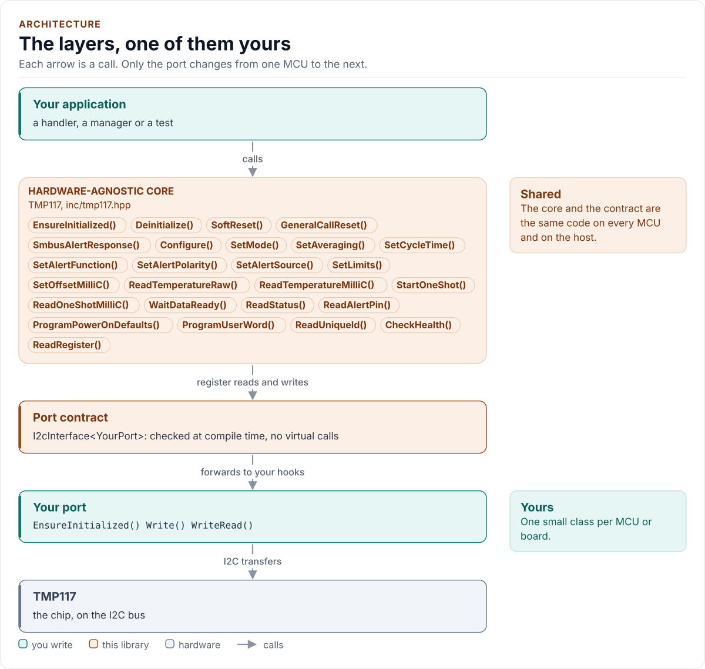
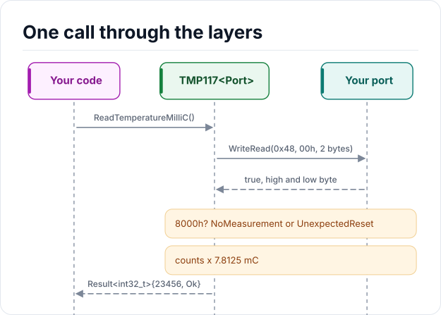

# Architecture

How the driver is built: three layers, one of them yours, and what happens in each when you read a temperature.

<!-- generated: datasheet-refs -->
??? abstract "Datasheet sections this page relies on"

    From Texas Instruments SNOSD82D D:

    - Result format, LSB and the 8000h value: 7.3.3 Temperature Result and Limits; Table 7-1, [p. 13](https://www.ti.com/lit/gpn/TMP117#page=13)
    - Register map and reset values: 7.6 Register Map; Table 7-3, [p. 25](https://www.ti.com/lit/gpn/TMP117#page=25)
    - Configuration register: 7.6.3 Configuration Register; Table 7-6, [p. 27](https://www.ti.com/lit/gpn/TMP117#page=27)

    All of them, with the driver API for each: [Datasheet map](datasheet.md).
<!-- /generated -->

<!-- figure: driver-layers -->
<picture>
  <source media="(prefers-color-scheme: dark)" srcset="diagrams/driver-layers.dark.svg">
  
</picture>
<!-- /figure -->

## Layers

| Layer | Files | Owns |
| --- | --- | --- |
| Core | [`inc/tmp117.hpp`](../inc/tmp117.hpp), [`src/tmp117.ipp`](../src/tmp117.ipp) | Lifecycle, the shadow of the chip's registers, conversions, the flag latch, reset evidence, the EEPROM sequence, timeouts, errors |
| Types and registers | [`inc/tmp117_types.hpp`](../inc/tmp117_types.hpp), [`inc/tmp117_registers.hpp`](../inc/tmp117_registers.hpp) | `Error`, `Result<T>`, `Config`, the cycle-time table, unit conversion; the register map and the bit fields |
| Port contract | [`inc/tmp117_i2c_interface.hpp`](../inc/tmp117_i2c_interface.hpp) | The CRTP base, the `I2cPort` concept, the bus requirements, `RegisterBus` (pointer and word framing) |
| Platform port | Your class | Bus bring-up and byte transfers, the delay, optionally the ALERT pin and logging |
| Kconfig layer | [`inc/tmp117_kconfig.hpp`](../inc/tmp117_kconfig.hpp) | Optional: a `Config` from ESP-IDF menuconfig |

## One call through the layers

<!-- figure: read-call -->
<picture>
  <source media="(prefers-color-scheme: dark)" srcset="diagrams/read-call.dark.svg">
  
</picture>
<!-- /figure -->

## Design choices

- **CRTP, not virtual functions.** The port is a template parameter constrained by the `I2cPort` concept, so every
  call is resolved at compile time and a missing hook is a compile error that names it.
- **Optional hooks by `requires`.** `DelayUs`, `ReadAlertPin` and `Log` are detected with C++20 `requires` in one
  place. A missing `DelayUs()` fails to compile, a missing `ReadAlertPin()` makes the driver call return
  `Unsupported`, a missing `Log()` logs nothing; none is skipped silently.
- **A shadow of the chip, adopted only after the chip accepted.** The driver keeps the configuration it believes the
  chip holds. A write that fails goes into a "doubt" mask; the next call reads the register back and keeps whichever
  of the old and the attempted value the chip shows. A value that is neither is a reset.
- **Reset evidence instead of a reset flag.** The chip has no power-on flag. The driver treats three things as a reset:
  the configuration setting bits differ from the shadow, EEPROM_Busy is set when the driver did not start a
  programming, or the result reads `8000h` after a real one. It then stops sending writes and returns
  `UnexpectedReset` ([Contract](contract.md)).
- **One writer for every register.** `RegisterBus::WriteWord` refuses the pointers of the read-only registers and of
  the two traceability words, so no code path can erase them.
- **Member buffers.** Transfer buffers are members of the driver, never stack arrays handed to an asynchronous port.
- **No I/O in the constructor.** Construction cannot fail, so the driver can be a static or a member of a handler.
- **One error type.** `Result<T>` carries a value and an `Error`; nothing throws and nothing returns a bare
  `bool`.
- **No heap, no exceptions, no RTTI, no `std::function`, no `printf`.** The driver is a header-only template with
  no mutable static state.

## Source map

| You want | Read |
| --- | --- |
| The public API | [`inc/tmp117.hpp`](../inc/tmp117.hpp) |
| How a call is implemented | [`src/tmp117.ipp`](../src/tmp117.ipp) |
| Register addresses and bits | [`inc/tmp117_registers.hpp`](../inc/tmp117_registers.hpp) |
| The port contract | [`inc/tmp117_i2c_interface.hpp`](../inc/tmp117_i2c_interface.hpp) |

Next: [Contract](contract.md).
