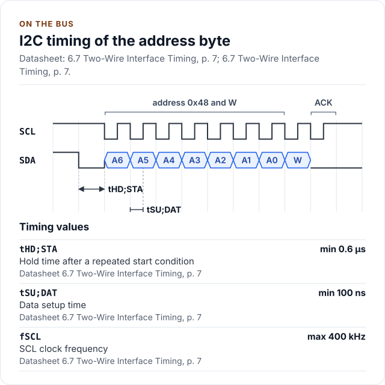
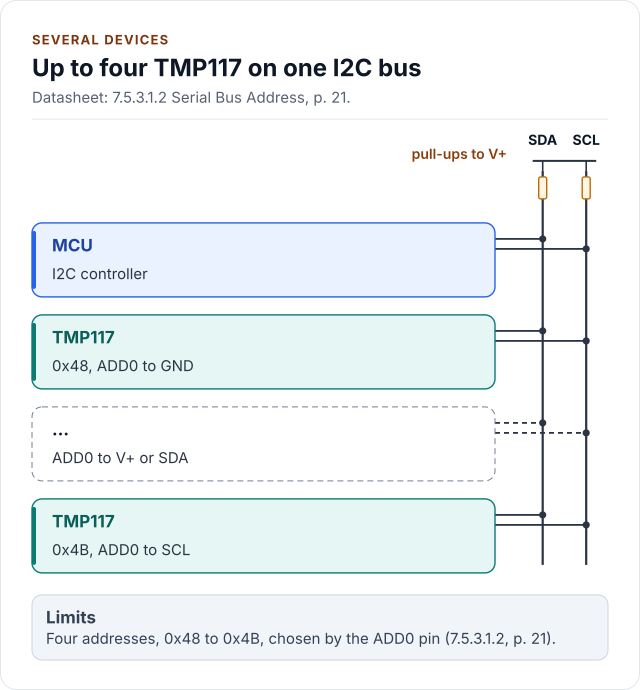

# On the bus

What the TMP117 needs from the bus, signal by signal, with every time and rate taken from the datasheet. The register
framing is on the [Hardware](hardware.md) page; this page is the waveform under it.

## I2C timing

The TMP117 is an I2C target at the address its ADD0 pin selects. Data changes while SCL is low and is read while SCL
is high; a start or a stop is SDA changing while SCL is high.

<!-- figure: bus-timing -->
<picture>
  <source media="(prefers-color-scheme: dark)" srcset="diagrams/bus-timing.dark.svg">
  
</picture>
<!-- /figure -->

## Several devices

Up to four TMP117 share one bus, each at the address its ADD0 pin selects.

<!-- figure: bus-topology -->
<picture>
  <source media="(prefers-color-scheme: dark)" srcset="diagrams/bus-topology.dark.svg">
  
</picture>
<!-- /figure -->

## How these figures are made

Each figure is a model in `docs/model/` (`bus-timing.timing.yml`, and `bus-topology.topology.yml` when the chip
shares a bus) that cites the datasheet section and page of every number; `kokeb-docs figures` draws it and the build
fails on a number without a citation. The values table under each waveform is also written as
`docs/diagrams/<id>.table.html`.
