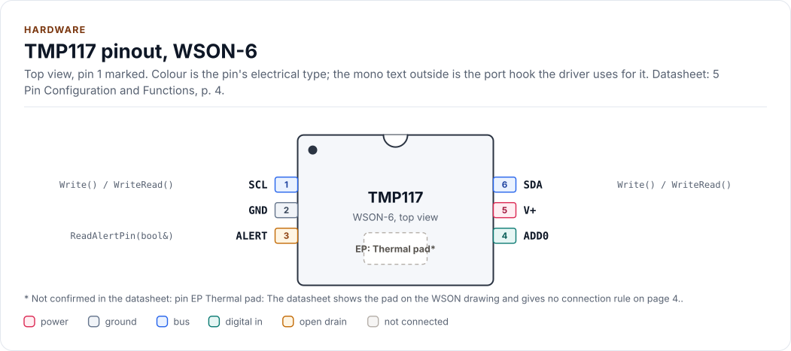
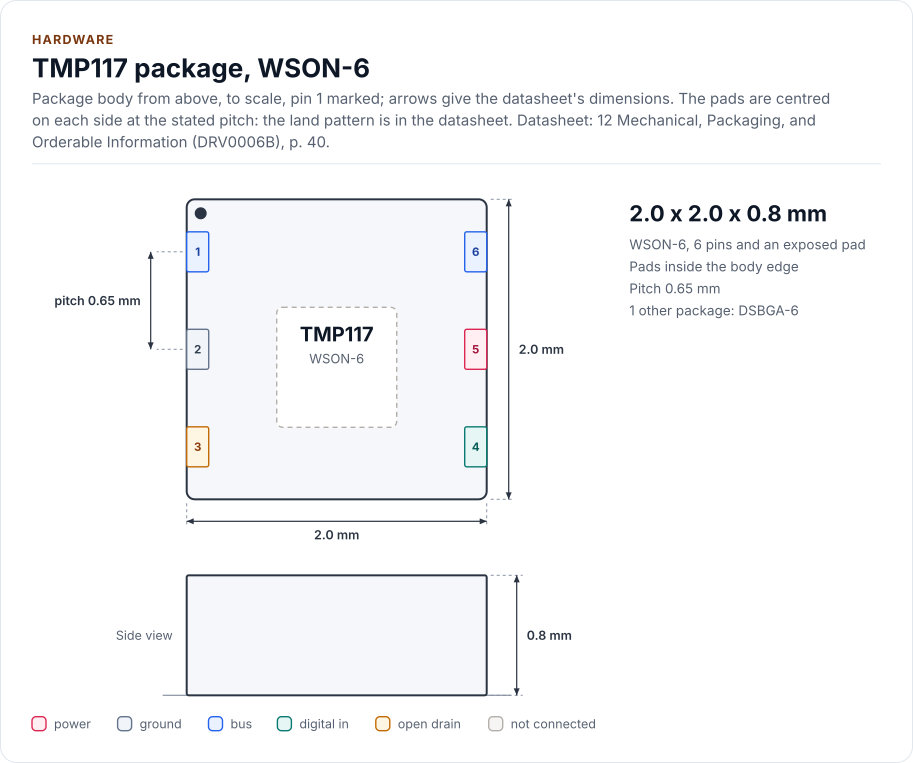
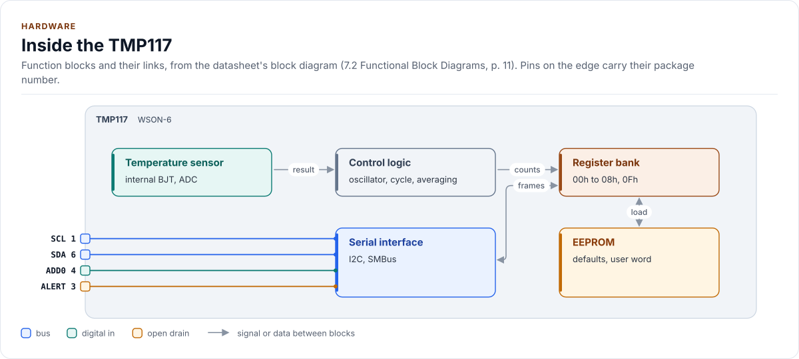
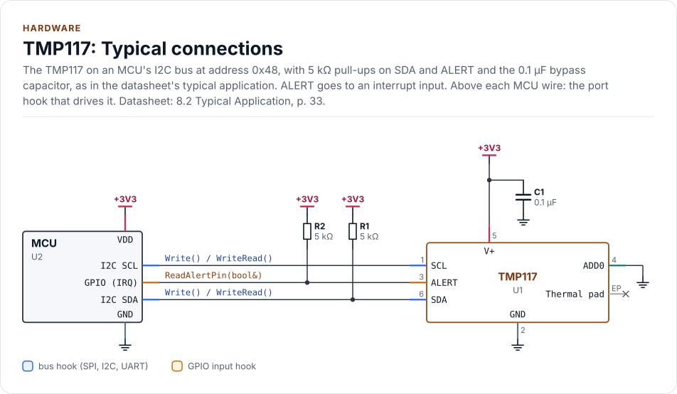
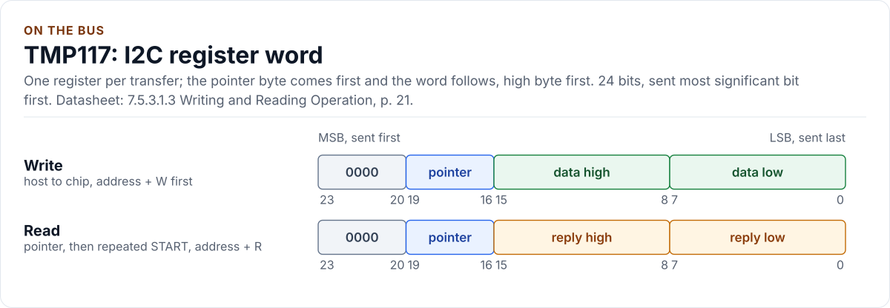
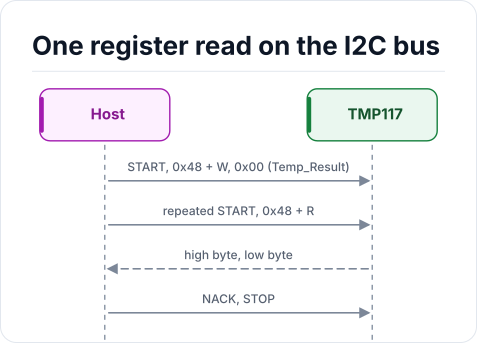

# Hardware

The TMP117's pins, bus settings, timing and power, as the driver uses them.

<!-- generated: datasheet-refs -->
??? abstract "Datasheet sections this page relies on"

    From Texas Instruments SNOSD82D D:

    - Pins and packages: 5 Pin Configuration and Functions, [p. 4](https://www.ti.com/lit/gpn/TMP117#page=4)
    - Supply range, supply current and shutdown current: 6.3 Recommended Operating Conditions; 6.5 Electrical Characteristics, [p. 5](https://www.ti.com/lit/gpn/TMP117#page=5)
    - Power-up, the EEPROM load and the first result: 7.3.1 Power-Up, [p. 12](https://www.ti.com/lit/gpn/TMP117#page=12)
    - Alert mode and therm mode: 7.4.4 Therm and Alert Modes, [p. 15](https://www.ti.com/lit/gpn/TMP117#page=15)
    - I2C addresses and the pointer register: 7.5.2 Pointer Register; 7.5.3.1.2 Serial Bus Address, [p. 20](https://www.ti.com/lit/gpn/TMP117#page=20)
    - Bus timeout and the SCL range: 7.5.3.1.7 Timeout Function; 6.7 Two-Wire Interface Timing, [p. 22](https://www.ti.com/lit/gpn/TMP117#page=22)
    - Device ID and the revision field: 7.6.11 Device ID Register, [p. 32](https://www.ti.com/lit/gpn/TMP117#page=32)
    - Typical connections and pull-ups: 8.2 Typical Application, [p. 33](https://www.ti.com/lit/gpn/TMP117#page=33)
    - Self-heating and averaging noise: 8.2.2 Detailed Design Procedure, [p. 34](https://www.ti.com/lit/gpn/TMP117#page=34)
    - Packages and ordering: 12 Mechanical, Packaging, and Orderable Information, [p. 39](https://www.ti.com/lit/gpn/TMP117#page=39)

    All of them, with the driver API for each: [Datasheet map](datasheet.md).
<!-- /generated -->

## Package and pins

The TMP117 comes in a 6-pin WSON (DRV, 2 mm square) and a 6-pin DSBGA (YBG, 1.53 x 1.00 mm). The pins are the same
signals in both:

<!-- figure: chip-pinout -->
<picture>
  <source media="(prefers-color-scheme: dark)" srcset="diagrams/chip-pinout.dark.svg">
  
</picture>
<!-- /figure -->

<!-- figure: chip-outline -->
<picture>
  <source media="(prefers-color-scheme: dark)" srcset="diagrams/chip-outline.dark.svg">
  
</picture>
<!-- /figure -->

<!-- generated: chip-pins -->
WSON-6, 6 pins and an exposed pad (5 Pin Configuration and Functions, [p. 4](https://www.ti.com/lit/gpn/TMP117#page=4)).

| Pin | Name | Type (domain) | Function | Driver hook | If unused | Datasheet |
| --- | --- | --- | --- | --- | --- | --- |
| 1 | `SCL` | bus (V+) | Serial clock, 5 kHz to 400 kHz (A15) | `Write() / WriteRead()` | - | 5, [p. 4](https://www.ti.com/lit/gpn/TMP117#page=4) |
| 2 | `GND` | ground | Ground | - | - | 5, [p. 4](https://www.ti.com/lit/gpn/TMP117#page=4) |
| 3 | `ALERT` | open drain (V+) | Over-temperature alert or data-ready, open drain, needs a pull-up | `ReadAlertPin(bool&)` | Leave open | 5, [p. 4](https://www.ti.com/lit/gpn/TMP117#page=4) |
| 4 | `ADD0` | digital in (V+) | Address select: GND 0x48, V+ 0x49, SDA 0x4A, SCL 0x4B | - | - | 7.5.3.1.2, [p. 21](https://www.ti.com/lit/gpn/TMP117#page=21) |
| 5 | `V+` | power (V+) | Supply, 1.8 V to 5.5 V | - | - | 6.3, [p. 5](https://www.ti.com/lit/gpn/TMP117#page=5) |
| 6 | `SDA` | bus (V+) | Serial data, open drain, needs a pull-up | `Write() / WriteRead()` | - | 5, [p. 4](https://www.ti.com/lit/gpn/TMP117#page=4) |
| EP | `Thermal pad` [^1] | not connected (GND) | Thermal pad, left unconnected | - | - | 8.2, [p. 33](https://www.ti.com/lit/gpn/TMP117#page=33) |

[^1]: Not confirmed in the datasheet: pin EP (Thermal pad): The datasheet shows the pad on the WSON drawing and gives no connection rule on page 4..

Source of this table and of the chip figures: [`docs/hardware.yml`](hardware.yml).
<!-- /generated -->

The DSBGA balls are A1 SDA, A2 SCL, B1 V+, B2 GND, C1 ADD0 and C2 ALERT. The thermal pad of the WSON is left
unconnected; the datasheet's layout page (section 10) is the place to check that for your board.

**ALERT and the driver's own reads.** In alert mode a read of Configuration clears HIGH_Alert and LOW_Alert and so
releases the ALERT pin (7.4.4.1, p. 16). The driver reads Configuration in `ReadStatus()`, `WaitDataReady()`,
`StartOneShot()`, `CheckHealth()` and the settle after a failed write, so an application that services ALERT as a level
interrupt can find the pin released by that polling. The flags are kept in `GetLatchedStatus()`; see the
[API guide](api-guide.md#alerts). Not hardware-verified.

## Inside the sensor

<!-- figure: chip-blocks -->
<picture>
  <source media="(prefers-color-scheme: dark)" srcset="diagrams/chip-blocks.dark.svg">
  
</picture>
<!-- /figure -->

The temperature sensor is an internal bipolar transistor and an ADC. The control logic and its oscillator run the
conversion cycle, the register bank holds the settings and the result, and the EEPROM supplies the register values at
power-up. The serial interface is I2C and SMBus compatible.

## Typical connections

<!-- figure: chip-circuit-typical -->
<picture>
  <source media="(prefers-color-scheme: dark)" srcset="diagrams/chip-circuit-typical.dark.svg">
  
</picture>
<!-- /figure -->

<!-- generated: chip-parts -->
| Part | Kind | Value | Connects | Datasheet |
| --- | --- | --- | --- | --- |
| U2 | MCU | - | VDD: +3V3, GND: GND, SCL: SCL, SDA: SDA, IRQ: ALERT | 8.2, [p. 33](https://www.ti.com/lit/gpn/TMP117#page=33) |
| C1 | capacitor | 0.1 µF | +3V3, GND | 8.2, [p. 33](https://www.ti.com/lit/gpn/TMP117#page=33) |
| R1 | resistor | 5 kΩ | +3V3, SDA | 8.2, [p. 33](https://www.ti.com/lit/gpn/TMP117#page=33) |
| R2 | resistor | 5 kΩ | +3V3, ALERT | 8.2, [p. 33](https://www.ti.com/lit/gpn/TMP117#page=33) |

Export a circuit for a schematic or PCB tool: `kokeb-docs hardware --kicad-netlist OUT.net --circuit typical`.
<!-- /generated -->

Both pull-ups are 5 kΩ in the datasheet's figure and can be higher or lower. SCL needs a pull-up only if the MCU pin is
open drain. Use a ceramic bypass capacitor rated for the whole temperature range and place it close to V+. Do not
heat the chip with its own supply current: the datasheet's section 8.2.2.2 gives the self-heating, which matters when
averaging is high and the cycle is short.

## Bus settings

| Setting | Value |
| --- | --- |
| Clock | 5 kHz to 400 kHz (fast mode). The datasheet lists 1 kHz, but a 3-byte write then outlasts the 20 ms minimum bus timeout ([A15](ambiguities.md#a15-the-bus-timeout)) |
| Address | 7-bit, `0x48` to `0x4B` from ADD0: GND `0x48`, V+ `0x49`, SDA `0x4A`, SCL `0x4B`; pass it to the constructor |
| Write | START, address + W, pointer, high byte, low byte, STOP |
| Read | START, address + W, pointer, repeated START, address + R, high byte, low byte, STOP |
| Words | Every register is 16 bits, high byte first; the pointer byte has its upper four bits at 0 |
| Pointer | The driver sends the pointer with every read, so it never relies on the chip remembering it |

<!-- figure: chip-frame-i2c -->
<picture>
  <source media="(prefers-color-scheme: dark)" srcset="diagrams/chip-frame-i2c.dark.svg">
  
</picture>
<!-- /figure -->

<!-- figure: bus-frame -->
<picture>
  <source media="(prefers-color-scheme: dark)" srcset="diagrams/bus-frame.dark.svg">
  
</picture>
<!-- /figure -->

The waveform under these frames is on [On the bus](bus.md). The driver also uses two special transfers: the
general-call reset (address `0x00`, byte `06h`, only with `allow_general_call`) and, in a later release, the SMBus
alert response.

## Timing

| Parameter | Value | Where | Driver |
| --- | --- | --- | --- |
| Power-up load | 1.5 ms typical, no maximum | 6.5, p. 7; 7.3.1, p. 12 | Wait 1.5 ms, then poll EEPROM_Busy until it reads 0, up to `reset_timeout_ms` (10 ms) |
| Soft reset | 2 ms | Table 7-6, p. 28 | `kSoftResetUs`, then the same poll |
| One conversion | 13 ms minimum, 15.5 ms typical, 17.5 ms maximum | 6.5, p. 6 | `kConversionMaxUs`; a one-shot waits `(n + 1) x 17.5 ms` for `n` averaged conversions |
| Conversion cycle | 15.5 ms to 16 s, longer with averaging | Table 7-7, p. 28 | `GetCycleTimeUs()`, from the table |
| EEPROM word | about 7 ms typical, no maximum | 6.6, p. 7; 7.5.1.2, p. 18 | Wait 7 ms, then poll up to `eeprom_timeout_ms` (50 ms); a lost-track switch-off waits 7 ms twice at most, then `Timeout` |
| Bus timeout | 20 ms to 40 ms (35 ms typical) | 6.7, p. 7; 7.5.3.1.7, p. 22 | Port contract: SCL of at least 5 kHz, short transactions |
| EEPROM endurance | 1000 writes minimum | 6.6, p. 7 | The driver never programs on its own, outside the [residual risks](contract.md#residual-risks) |

Where the datasheet prints only a typical value the driver adds a bounded poll instead of trusting it; the choice is
[A1 and A2](ambiguities.md#a1-and-a2-the-two-waits).

## Power

| Mode | Supply current (typical) | Where |
| --- | --- | --- |
| Shutdown | 0.15 µA (0.5 µA maximum at 25 °C) | 6.5, p. 6 |
| Standby between conversions | 1.25 µA | 6.5, p. 6 |
| One result per second, no averaging | 3.5 µA | 6.5, p. 6 |
| One result per second, 8 averaged | 16 µA | 6.5, p. 6 |
| Converting | 135 µA | 6.5, p. 6 |

`Deinitialize()` puts a chip it has reached in shutdown; on a driver that never reached the chip it sends nothing
(row N1 of the [decision table](contract.md#switch-off-decision-table)). The supply is 1.8 V to 5.5 V over the whole
temperature range, and 1.7 V up to 70 °C (6.3, p. 5).

## Silicon revisions

The Device_ID register holds the revision in bits 15:12 and the part in bits 11:0 (`0x117`). The datasheet defines no
value for any revision, so the driver accepts any, reports it with `GetRevision()` and does nothing different for it.
A TMP119 has `0x2117`, which this driver reads as revision 2 of a TMP117: it cannot tell the two apart
([A13](ambiguities.md#a13-the-revision-field)). The grades TMP117A, M and N share the register map and differ
in accuracy and range; the chip does not say which one it is.

## Reference documents

The datasheet: [TMP117 datasheet](https://www.ti.com/lit/gpn/TMP117) (SNOSD82D). Every pin, setting and timing on
this page cites a section of it; its revision, its SHA-256 and the sections each page relies on are in
[`docs/datasheets.yml`](datasheets.yml).

<!-- generated: datasheet-card -->
| Document | Revision | Get it |
| --- | --- | --- |
| Datasheet: TMP117 High-Accuracy, Low-Power, Digital Temperature Sensor With SMBus- and I2C-Compatible Interface (Texas Instruments SNOSD82D) | D, September 2022 | [PDF](https://www.ti.com/lit/gpn/TMP117) · [vendor page](https://www.ti.com/product/TMP117) |
| Application note: Precise Temperature Measurements With TMP116 and TMP117 (Texas Instruments SNOA986) | A, 2019-08 | [PDF](https://www.ti.com/lit/pdf/SNOA986) · [vendor page](https://www.ti.com/product/TMP117) |
| Application note: Fixed-point interpretation of the temperature output (Texas Instruments SBAA588) | A, 2025-01 | [PDF](https://www.ti.com/lit/pdf/SBAA588) · [vendor page](https://www.ti.com/product/TMP117) |
| Application note: Alert and therm threshold design across temperature sensors (Texas Instruments SDAA311) | none stated, 2026-03 | [PDF](https://www.ti.com/lit/pdf/SDAA311) · [vendor page](https://www.ti.com/product/TMP117) |

Written against these revisions; the SHA-256 of each file is in [`docs/datasheets.yml`](datasheets.yml). Where each part
of the driver is in the datasheet: [Datasheet map](datasheet.md).
<!-- /generated -->

| Also useful | Contents |
| --- | --- |
| [`inc/tmp117_registers.hpp`](../inc/tmp117_registers.hpp) | The register map as the driver uses it, with datasheet section numbers |
