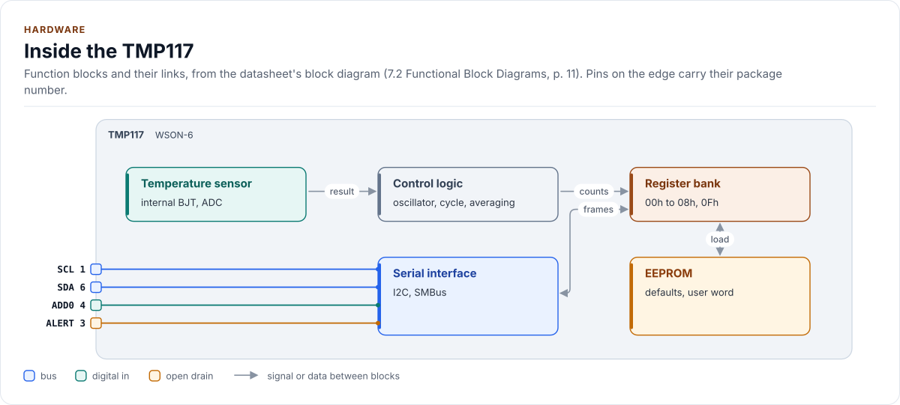
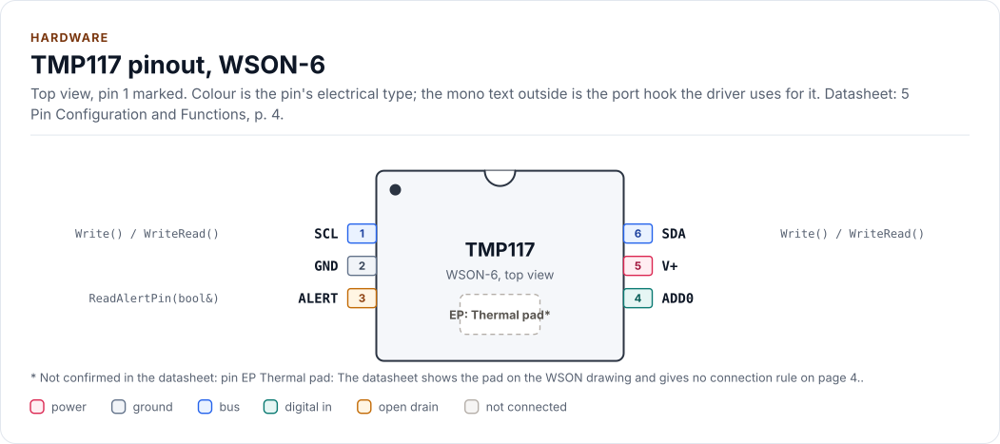
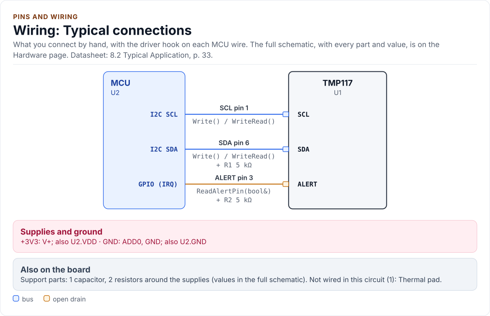
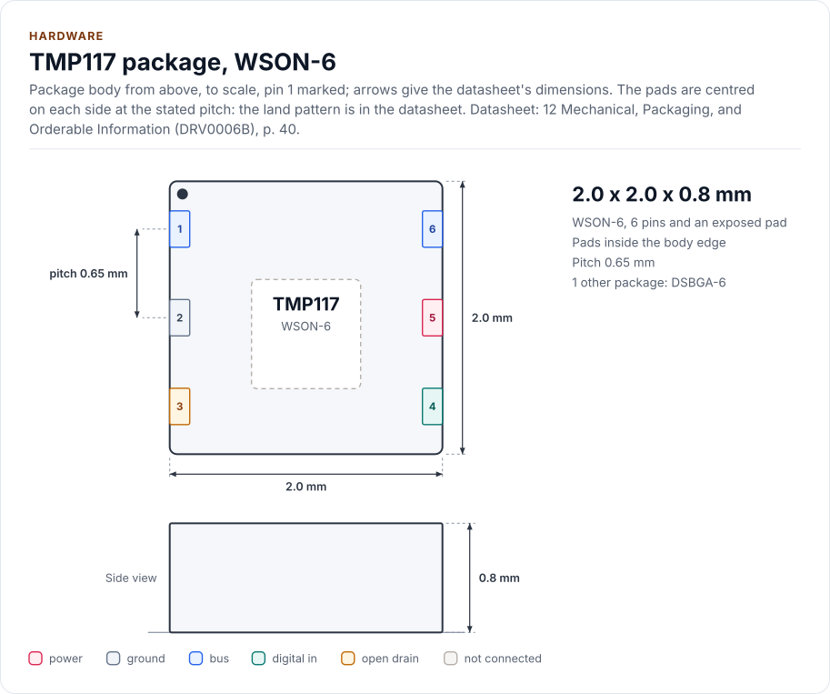
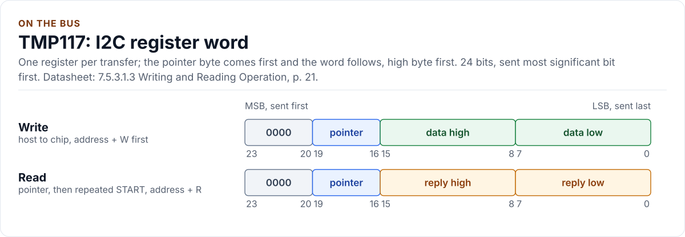

---
hide:
  - navigation
  - toc
---

<div class="kb-hero" markdown>
<span class="kb-kicker">Driver</span>

# TMP117 Driver

<p>A C++20 driver for the Texas Instruments TMP117 digital temperature sensor. It waits for the power-up load, checks
the Device_ID, runs continuous or one-shot conversions, latches the alert flags and programs the alert limits, on any
MCU.</p>

[Quickstart](quickstart.md){ .md-button .md-button--primary }
[API guide](api-guide.md){ .md-button }
[Source on GitHub](https://github.com/kokeb-labs-drivers/driver-tmp117){ .md-button }
</div>

<!-- generated: chip-summary -->
The **TMP117** is a digital temperature sensor with a 16-bit result in steps of 1/128 °C, accurate to 0.1 °C from -20 °C
to 50 °C, a programmable alert window and a small EEPROM, read over I2C or SMBus (1 Features, [p.
1](https://www.ti.com/lit/gpn/TMP117#page=1)).
<!-- /generated -->


<!-- figure: chip-hero -->
<picture>
  <source media="(prefers-color-scheme: dark)" srcset="diagrams/chip-hero.dark.svg">
  
</picture>
<!-- /figure -->

## What it does

<!-- figure: chip-capabilities -->
<picture>
  <source media="(prefers-color-scheme: dark)" srcset="diagrams/chip-capabilities.dark.svg">
  
</picture>
<!-- /figure -->

## Where it is used

<!-- generated: chip-uses -->
- Electronic thermometers
- Wireless environmental sensors
- Thermostats
- Cold chain asset tracking
- Temperature transmitters

Uses named by the datasheet (1 Features, [p. 1](https://www.ti.com/lit/gpn/TMP117#page=1)).
<!-- /generated -->

## Inside the sensor

<!-- figure: chip-blocks -->
<picture>
  <source media="(prefers-color-scheme: dark)" srcset="diagrams/chip-blocks.dark.svg">
  
</picture>
<!-- /figure -->

## Pins and wiring

<!-- figure: chip-pinout -->
<picture>
  <source media="(prefers-color-scheme: dark)" srcset="diagrams/chip-pinout.dark.svg">
  
</picture>
<!-- /figure -->

<!-- figure: chip-wiring-typical -->
<picture>
  <source media="(prefers-color-scheme: dark)" srcset="diagrams/chip-wiring-typical.dark.svg">
  
</picture>
<!-- /figure -->

<!-- figure: chip-outline -->
<picture>
  <source media="(prefers-color-scheme: dark)" srcset="diagrams/chip-outline.dark.svg">
  
</picture>
<!-- /figure -->

<!-- figure: chip-frame-i2c -->
<picture>
  <source media="(prefers-color-scheme: dark)" srcset="diagrams/chip-frame-i2c.dark.svg">
  
</picture>
<!-- /figure -->

<div class="kb-chip" markdown>
<div class="kb-chip__head">
<span class="kb-chip__kicker">High-accuracy digital temperature sensor</span>
<span class="kb-chip__name">TMP117</span>
<span class="kb-chip__vendor">Texas Instruments</span>
</div>

Function
:   Temperature, 16-bit result at 1/128 °C per count; ±0.1 °C from -20 °C to 50 °C

Interface
:   I2C and SMBus, 5 kHz to 400 kHz (the datasheet lists 1 kHz, see A15); 7-bit address `0x48` to `0x4B` from the
    ADD0 pin; one pointer byte, 16-bit words

Conversions
:   Continuous (cycle 15.5 ms to 16 s), shutdown, or one-shot; averaging of 1, 8, 32 or 64 conversions

Alert
:   High and low limits on an open-drain ALERT pin: alert mode or therm mode, either polarity, or data-ready

Memory
:   EEPROM for the power-on configuration, limits and offset, one user word and two traceability words

Supply
:   1.8 V to 5.5 V (1.7 V up to 70 °C); 3.5 µA at one result per second, 0.15 µA in shutdown
</div>

Every pin, the reference circuits, the bus settings, the timing and the power: [Hardware](hardware.md).

## Quick start

Wire the chip as above, write the port for your MCU ([Porting](porting.md)), then:

<!-- generated: quickstart-code -->
```cpp
#include "tmp117.hpp"

int read_board_temperature(MyPort& port, int32_t& milli_celsius) {
  tmp117::TMP117<MyPort> sensor(port); // address 0x48 (ADD0 to GND), no I/O yet

  if (auto r = sensor.EnsureInitialized(); !r) { // 1. wait for the power-up load, Device_ID, config
    return static_cast<int>(r.error);            //    Bus, Timeout or DeviceIdMismatch: wiring
  }
  const auto t = sensor.ReadTemperatureMilliC(); // 2. the latest continuous result
  if (!t) {
    return static_cast<int>(t.error); //    NoMeasurement: wait one cycle and ask again
  }
  milli_celsius = t.value; // 3. thousandths of a degree Celsius, 7.8125 mC per count
  return 0;
}
```
<!-- /generated -->

Every step, with the port and what to check when it does not work: [Quickstart](quickstart.md).

## Driver coverage

<!-- generated: chip-coverage -->
| Capability | What the chip does | Driver API | Registers | Status | Datasheet |
| --- | --- | --- | --- | --- | --- |
| [Temperature](api-guide.md) | A 16-bit result, 7.8125 m°C per count, never the 8000h value before a conversion | `ReadTemperatureRaw`, `ReadTemperatureMilliC` | `Temp_Result` (`kTempResult`) | Supported | 7.3.3, [p. 13](https://www.ti.com/lit/gpn/TMP117#page=13) |
| [Averaging and cycle time](configuration.md) | 1, 8, 32 or 64 conversions per result and eight cycle times, checked against Table 7-7 | `SetAveraging`, `SetCycleTime` | `Configuration` (`kConfiguration`) | Supported | 7.6.3, [p. 27](https://www.ti.com/lit/gpn/TMP117#page=27) |
| [Continuous, shutdown, one-shot](api-guide.md) | Converts continuously, sleeps at 0.15 µA, or takes one result on request | `SetMode`, `StartOneShot`, `ReadOneShotMilliC`, `WaitDataReady` | `Configuration` (`kConfiguration`) | Supported | 7.4, [p. 14](https://www.ti.com/lit/gpn/TMP117#page=14) |
| [Alert window and therm](api-guide.md) | ALERT outside a window (alert mode) or above a limit with hysteresis (therm mode), flags latched | `SetAlertFunction`, `SetAlertPolarity`, `SetAlertSource`, `SetLimits`, `ReadStatus`, `ReadAlertPin` | `THigh_Limit` (`kHighLimit`), `TLow_Limit` (`kLowLimit`) | Supported | 7.4.4, [p. 15](https://www.ti.com/lit/gpn/TMP117#page=15) |
| [Offset trim](configuration.md) | The chip adds a signed offset to every result, up to ±256 °C in 7.8125 m°C steps | `SetOffsetMilliC` | `Temp_Offset` (`kTempOffset`) | Supported | 7.6.9, [p. 31](https://www.ti.com/lit/gpn/TMP117#page=31) |
| [Power-on defaults](api-guide.md) | Stores the configuration, limits and offset so the chip starts alone; every step checked and relocked | `ProgramPowerOnDefaults`, `ProgramUserWord` | `EEPROM_UL` (`kEepromUnlock`), `EEPROM2` (`kEeprom2`) | Guarded | 7.5.1, [p. 18](https://www.ti.com/lit/gpn/TMP117#page=18) |
| [Identity and traceability](hardware.md) | Checks Device_ID before anything else and reads the two NIST traceability words | `EnsureInitialized`, `ReadUniqueId`, `GetRevision` | `Device_ID` (`kDeviceId`), `EEPROM1` (`kEeprom1`), `EEPROM3` (`kEeprom3`) | Supported | 7.6.11, [p. 32](https://www.ti.com/lit/gpn/TMP117#page=32) |
| [Soft and general-call reset](ambiguities.md) | Soft reset by default; the bus-wide general-call reset only when you opt in | `SoftReset`, `GeneralCallReset` | `Configuration` (`kConfiguration`) | Guarded | 7.6.3, [p. 27](https://www.ti.com/lit/gpn/TMP117#page=27) |
| [SMBus alert response](ambiguities.md) | The bus-wide alert address read; the driver returns Unsupported and says why | - | - | Not covered | 7.5.3.1, [p. 20](https://www.ti.com/lit/gpn/TMP117#page=20) |

**Supported**: the driver covers it and a host test checks it; **Guarded**: covered, behind an explicit acknowledgement
because a wrong value can do harm; **Not covered**: the chip has it and the driver leaves it alone.

From [`docs/hardware.yml`](hardware.yml); `kokeb-docs hardware --check` confirms that every API name is in
`inc/tmp117.hpp` and every register (the header constant in brackets, where the header spells it otherwise) in
`inc/tmp117_registers.hpp`.
<!-- /generated -->

The driver has no platform code. You give it a small class that brings the bus up and moves bytes; it does the rest: the
power-up wait, the Device_ID check, register framing, unit conversion, the flag latch and every timeout.

## What you get

- **One object per chip.** `TMP117<YourPort>` takes a reference to your port and does no I/O until
  `EnsureInitialized()`. See [API guide](api-guide.md).
- **Errors you can act on.** Every call returns `Result<T>` with an `Error` such as `Bus`, `Timeout`,
  `DeviceIdMismatch`, `NoMeasurement` or `UnexpectedReset`. See [API guide](api-guide.md#handle-errors).
- **Datasheet defaults.** `Config{}` holds the chip's reset values, with units in the field names. See
  [Configuration](configuration.md).
- **A guarded EEPROM path.** One call programs the power-on defaults, relocks the chip on every failure path and
  verifies the result. See [API guide](api-guide.md#program-the-power-on-defaults).
- **The open questions in the open.** Each place the datasheet is silent or contradicts itself is listed with the
  driver's choice and the switch that tests the other reading. See [Ambiguities](ambiguities.md).
- **Zero-overhead portability.** The port is a CRTP class checked by a concept: the bus hooks and a delay, plus an
  optional ALERT-pin hook and logging found at compile time. See [Porting](porting.md).
- **No heap, no exceptions, no RTTI.** The host tests build with `-fno-exceptions -fno-rtti`. See
  [Contract](contract.md).
- **Tested without hardware.** Host tests run the driver against a register model of the chip written from the
  datasheet alone. See [Testing and CI](testing.md).

## Datasheet

<!-- generated: datasheet-card -->
| Document | Revision | Get it |
| --- | --- | --- |
| Datasheet: TMP117 High-Accuracy, Low-Power, Digital Temperature Sensor With SMBus- and I2C-Compatible Interface (Texas Instruments SNOSD82D) | D, September 2022 | [PDF](https://www.ti.com/lit/gpn/TMP117) · [vendor page](https://www.ti.com/product/TMP117) |
| Application note: Precise Temperature Measurements With TMP116 and TMP117 (Texas Instruments SNOA986) | A, 2019-08 | [PDF](https://www.ti.com/lit/pdf/SNOA986) · [vendor page](https://www.ti.com/product/TMP117) |
| Application note: Fixed-point interpretation of the temperature output (Texas Instruments SBAA588) | A, 2025-01 | [PDF](https://www.ti.com/lit/pdf/SBAA588) · [vendor page](https://www.ti.com/product/TMP117) |
| Application note: Alert and therm threshold design across temperature sensors (Texas Instruments SDAA311) | none stated, 2026-03 | [PDF](https://www.ti.com/lit/pdf/SDAA311) · [vendor page](https://www.ti.com/product/TMP117) |

Written against these revisions; the SHA-256 of each file is in [`docs/datasheets.yml`](datasheets.yml). Where each part
of the driver is in the datasheet: [Datasheet map](datasheet.md).
<!-- /generated -->

## Where to go next

<div class="grid cards" markdown>

-   :material-rocket-launch-outline: **[Quickstart](quickstart.md)**

    ---

    Wire the chip, write the port, read a temperature in about 15 lines.

-   :material-chip: **[Hardware](hardware.md)**

    ---

    Pins, bus settings, timing and power.

-   :material-file-document-check-outline: **[Contract](contract.md)**

    ---

    What the driver promises, what it needs, threading and errors.

-   :material-code-braces: **[API guide](api-guide.md)**

    ---

    Initialise, configure, measure and handle errors, task by task.

-   :material-swap-horizontal: **[Porting](porting.md)**

    ---

    Implement the port for your MCU.

-   :material-book-open-variant: **[API reference](api-reference.md)**

    ---

    Every class and member, generated from the headers.

</div>
